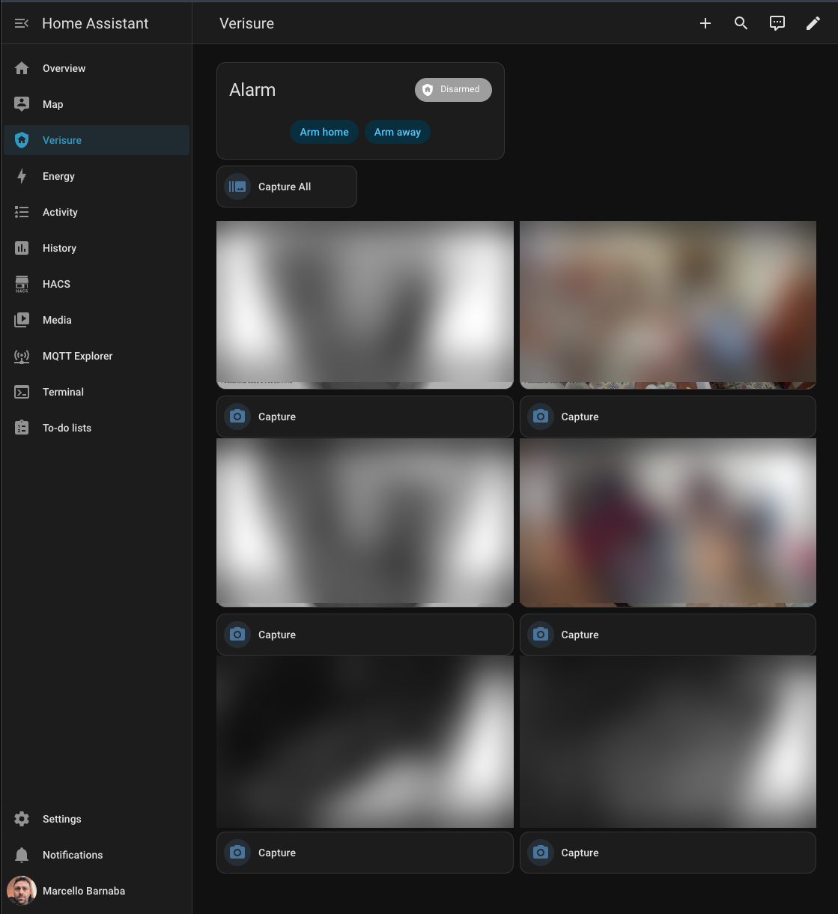
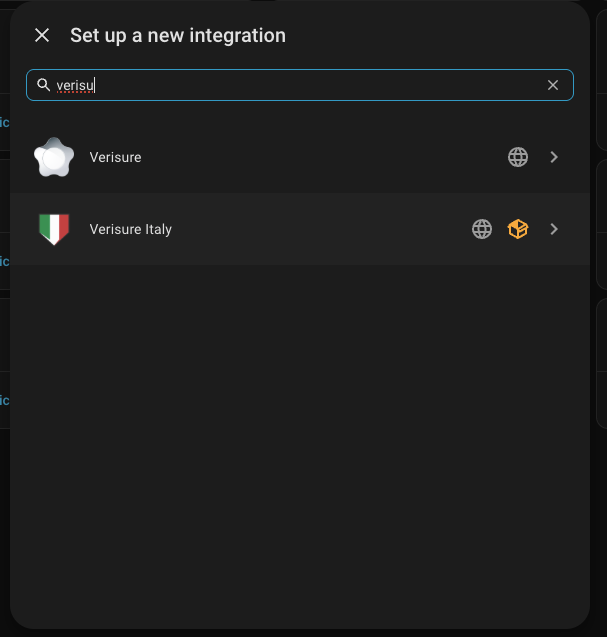
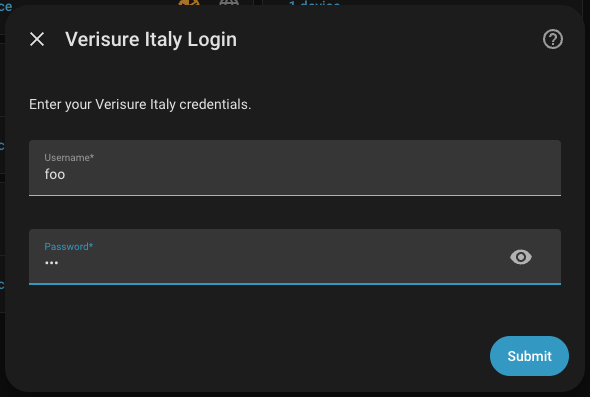
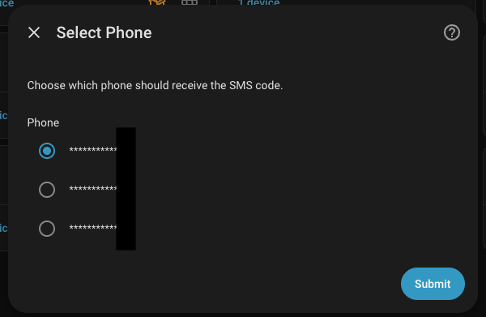
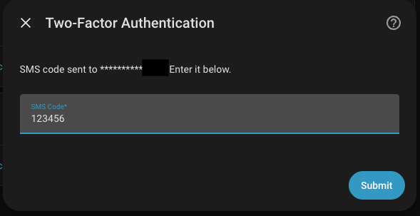
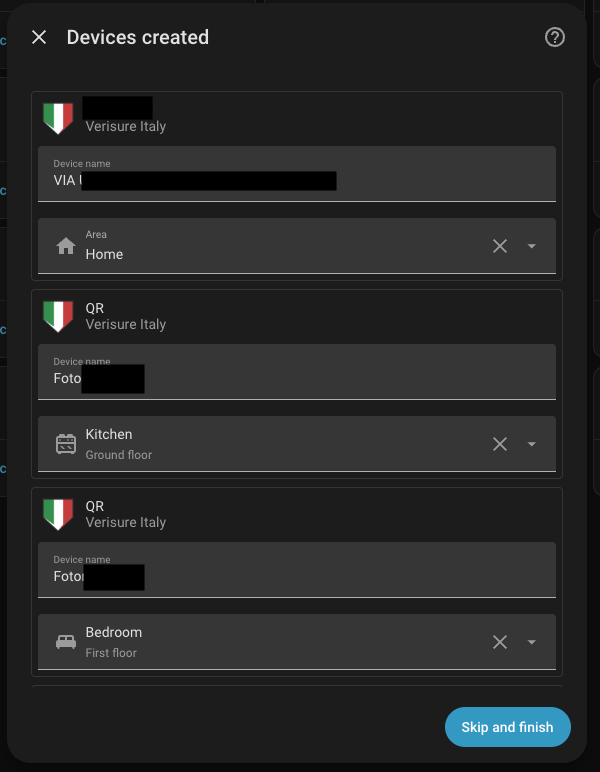
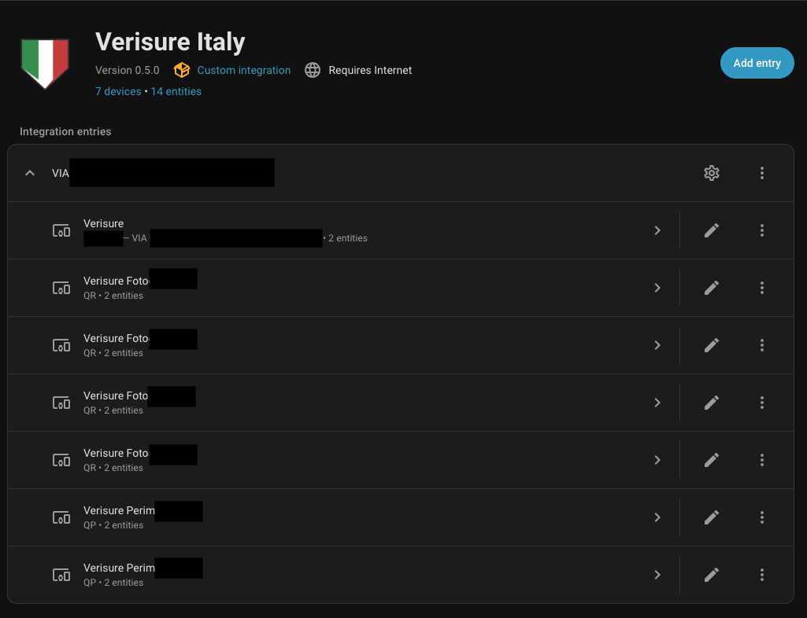
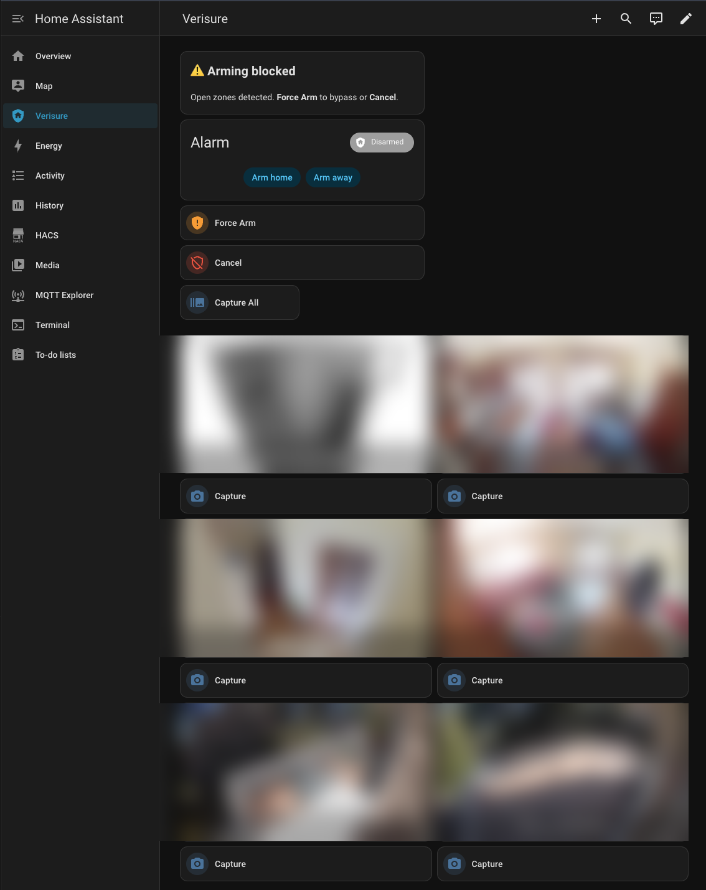

<p align="center">
  
</p>

# Verisure Italy for Home Assistant

[](https://github.com/hacs/integration)
[](https://github.com/vjt/ha-verisure-italy/releases)
[](LICENSE)
[](https://github.com/vjt/ha-verisure-italy/actions/workflows/ci.yml)
[](https://codecov.io/gh/vjt/ha-verisure-italy)

Home Assistant custom component for **Verisure Italy** alarm systems.

Talks directly to `customers.verisure.it/owa-api/graphql`. Fully
replaces the Verisure mobile app for alarm control and camera monitoring.

> **Not affiliated with Verisure Group or Securitas Direct.** This project is
> not endorsed by or connected to Verisure Group, Securitas Direct, or any of
> their subsidiaries. All product names, trademarks, and registered trademarks
> are property of their respective owners.

📖 Long-form walk-through: **[How I replaced the Verisure app with Home Assistant](https://sindro.me/posts/2026-04-04-verisure-italy-home-assistant/)** ([🇮🇹 italiano](https://sindro.me/it/posts/2026-04-04-verisure-italy-home-assistant/))

[](https://my.home-assistant.io/redirect/hacs_repository/?owner=vjt&repository=ha-verisure-italy&category=integration)

<p align="center">
  
</p>

## Features

- **Alarm control** — arm home (partial+perimeter), arm away (total+perimeter), disarm
- **Force arm** — open zone detection with one-tap force-arm and cancel buttons on the dashboard
- **Cameras** — auto-discovered, parallel on-demand capture with per-camera and capture-all buttons
- **Auto-managed dashboard** — Lovelace dashboard auto-populated with alarm panel, camera grid, and capture buttons
- **Passive polling** via xSStatus — no panel ping, no timeline spam
- **Configurable** — poll interval, operation timeout, poll delay and disarm confirmation delay tunable from the UI
- **Config flow** with 2FA/OTP support

## Installation (HACS)

The fastest path: click the **Open in HACS** badge above. It opens your
HA instance's HACS UI prepared to add this repo as a custom integration
— review and confirm.

Or manually:

1. Open **HACS** in Home Assistant
2. Click **...** (top right) → **Custom repositories**
3. Add `https://github.com/vjt/ha-verisure-italy` as **Integration**
4. Search for "Verisure Italy" and install
5. Restart Home Assistant
6. Go to **Settings → Devices & Services → Add Integration → Verisure Italy**

The API client (`verisure-italy`) is installed automatically from
[PyPI](https://pypi.org/project/verisure-italy/).

## Setup

<details>
<summary>Step-by-step setup screenshots</summary>

### 1. Find the integration



### 2. Enter credentials



### 3. Select phone for 2FA



### 4. Enter SMS code



### 5. Devices are created



### 6. Integration page



</details>

## Dashboard

The integration automatically creates a **Verisure** dashboard in the
sidebar on setup. It's populated with the alarm panel, camera grid, and
capture buttons based on discovered entities. The dashboard updates
itself on every integration reload and is removed when the integration
is unloaded.

## Alarm State Mapping

| Panel State | Proto | HA State | Action |
|---|---|---|---|
| Disarmed | `D` | Disarmed | disarm |
| Partial + Perimeter | `B` | Armed Home | arm_home |
| Total + Perimeter | `A` | Armed Away | arm_away |
| Perimeter only | `E` | Armed Custom Bypass | display only |
| Partial (no peri) | `P` | Armed Custom Bypass | display only |
| Total (no peri) | `T` | Armed Custom Bypass | display only |

## Entity IDs

| Entity | Example ID |
|---|---|
| Alarm panel | `alarm_control_panel.verisure_alarm` |
| Camera | `camera.verisure_fotocucina` |
| Capture button | `button.verisure_fotocucina_capture` |
| Capture all | `button.verisure_capture_all_cameras` |
| Force arm | `button.verisure_force_arm` |
| Cancel force arm | `button.verisure_cancel_force_arm` |

## Force Arm

A forgotten open window shouldn't leave your house unprotected.
Verisure panels refuse to arm when a zone is open — but an unarmed
alarm is worse than an armed one with exceptions. This integration
detects the blocked arming and lets you force-arm with one tap,
or automate it entirely so leaving the house always arms the alarm.

When arming fails because a zone is open, the integration:

1. Shows an alert banner on the dashboard listing the open zones
2. Fires a `verisure_italy_arming_exception` event (for automations)
3. Makes the **Force Arm** and **Cancel** buttons available

<p align="center">
  
</p>

Tap **Force Arm** to arm anyway, bypassing the open zones. Tap
**Cancel** to abort. The buttons disappear automatically once
used or after 2 minutes.

For full automation, use the [auto force-arm example](docs/automations.md#muscle-auto-force-arm-when-leaving)
to bypass open zones automatically when leaving home — no manual
intervention needed.

> **Note:** Force arm requires an **administrator** API user.
> A restricted user will arm regardless of open zones without
> raising exceptions — and sensors will trip.

## Smoke Test

After a Home Assistant update, run the smoke test to verify
everything still works:

```bash
./scripts/smoke_test.sh
```

Checks all entities, services, and the dashboard panel are
registered and responding. Takes about 3 seconds, does not
arm or disarm.

## Stability

The integration uses stable HA public APIs for entities
(`CoordinatorEntity`, `ButtonEntity`, `AlarmControlPanelEntity`)
and is expected to survive HA updates without changes.

The **auto-managed dashboard** uses `LovelaceStorage` internals
and `frontend.async_register_built_in_panel`. If a HA update
breaks the dashboard, the alarm, cameras, and buttons still work
— you just won't get the auto-generated sidebar panel. Build a
manual dashboard as a fallback.

The **Verisure API** (`customers.verisure.it`) is the real risk
factor — GraphQL schema or auth flow changes are outside our
control. The API client is a separate package
([verisure-italy](https://pypi.org/project/verisure-italy/))
to isolate those changes.

## Architecture

- [Client library architecture](docs/architecture-client.md) — API client internals, auth flow, state model, exception hierarchy
- [Integration architecture](docs/architecture-integration.md) — HA entities, coordinator, force-arm state machine, security model
- [Hacking guide](docs/hacking.md) — dev setup, deploy workflow, engineering rules, API gotchas, releasing
- [Example automations](docs/automations.md) — arm on leave, safety net, force-arm, night arm, morning disarm, actionable disarm notification, unknown state alert

## Development

```bash
python3 -m venv .venv
source .venv/bin/activate
pip install -e ".[dev]"

pytest tests/ -x -q
pyright verisure_italy/ custom_components/
ruff check verisure_italy/ tests/ custom_components/
```

## License

MIT. See [LICENSE](LICENSE).

## Comparison with securitas-direct-new-api

[guerrerotook/securitas-direct-new-api](https://github.com/guerrerotook/securitas-direct-new-api)
("Verisure OWA", domain `securitas`) is the multi-country integration
in the HACS default catalog. It supports Italy too, and talks to the
same API. Compared against its v5.11.0 release:

| | securitas-direct-new-api | This integration |
|---|---|---|
| Scope | 10 countries; alarm, cameras, smart locks, annex, environmental sensors, custom cards | Italy only; alarm and cameras |
| Commands sent to the panel | Chosen at runtime by trial: candidate commands are sent in order, any the API rejects with HTTP 400/404 is stored as unsupported, and the next one is tried ([`_base.py`](https://github.com/guerrerotook/securitas-direct-new-api/blob/v5.11.0/custom_components/securitas/alarm_control_panel/_base.py#L843-L907)). Away with perimeter tries the Spanish alias `ARMINTEXT1` before the Italian `ARM1PERI1` ([`command_resolver.py`](https://github.com/guerrerotook/securitas-direct-new-api/blob/v5.11.0/custom_components/securitas/verisure_owa_api/command_resolver.py#L85-L91)) | Decided before anything is sent: the official web app's own command logic (decoded from its JS bundle), restricted to the services the installation reports as active. Panel models the Italian API doesn't list get no commands at all: arm and disarm are refused and a diagnostic is logged. Verified live on `SDVECU` |
| Perimeter support | On if any of four heuristics says so: JWT capability, service flag, service attribute, partition `02` permissions ([`capabilities.py`](https://github.com/guerrerotook/securitas-direct-new-api/blob/v5.11.0/custom_components/securitas/verisure_owa_api/capabilities.py)) | Partition `02` permissions only, the same check Verisure's own web app makes |
| HA button → panel state | Configured by the user. With the defaults for a perimeter install, Partial + Perimeter (`B`) has no button and shows as `armed_custom_bypass` | Fixed, see [Alarm State Mapping](#alarm-state-mapping); setup asks only for login, 2FA and installation |
| Brief false "disarmed" from the API while the panel stays armed | Published as reported | Held until a second poll confirms it ([phantom disarm](docs/findings/phantom-disarm.md)) |

Working out the panel at runtime is the reasonable design for one
integration that has to serve every Verisure panel in every
country. This integration gives up that coverage so that its
behaviour is decided before anything is sent: no command goes out
just to find out whether the panel accepts it.

If you are outside Italy, or need locks, annex or environmental
sensors, use securitas-direct-new-api. If you have an Italian panel,
this integration does less, and every command it sends is chosen
before it goes out.
